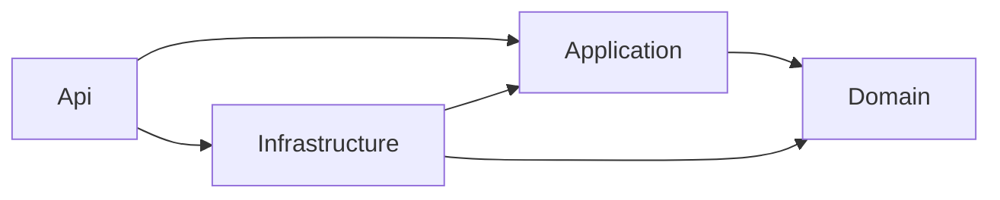

# Arquitectura y convenciones

HotelManagement utiliza .NET 10, ASP.NET Core, PostgreSQL y EF Core. Los casos
de uso siguen CQRS con MediatR 12.5.0; la interfaz Aurora es una web estática
servida por la API y utiliza autenticación por cookie del mismo origen.

## Estructura

```text
HotelManagement/
├── src/
│   ├── HotelManagement.Api/
│   │   ├── Authorization/       Roles y políticas de acceso
│   │   ├── Configuration/       Registro de servicios HTTP y autenticación
│   │   ├── Controllers/         Endpoints que envían Commands y Queries
│   │   ├── ErrorHandling/       ProblemDetails y manejo central de errores
│   │   └── wwwroot/             Interfaz Aurora: HTML, CSS, JS e imágenes
│   ├── HotelManagement.Application/
│   │   ├── Configuration/       AddApplication y registro de MediatR
│   │   ├── Dtos/                Contratos agrupados por funcionalidad
│   │   ├── Exceptions/          Errores de aplicación
│   │   ├── Security/            Contrato del servicio de hashing
│   │   └── UseCases/            Commands, Queries y mapeos por funcionalidad
│   ├── HotelManagement.Domain/
│   │   ├── Entities/            Entidades sin dependencias de persistencia
│   │   └── Repositories/        Contratos de acceso a datos por entidad
│   └── HotelManagement.Infrastructure/
│       ├── Configuration/       AddInfrastructure y registro de dependencias
│       ├── Persistence/         HotelManagementDbContext y modelo de EF Core
│       ├── Repositories/        Implementaciones PostgreSQL
│       └── Security/            Hashing y aprovisionamiento demo
├── database/                    Esquema, seed e incrementos SQL versionados
├── tests/HotelManagement.Api.Tests/
├── scripts/                     Publicación y verificación de entrega local
├── .github/workflows/ci.yml      Compilación, PostgreSQL, pruebas y publicación
└── docs/                        Arquitectura, decisiones y evidencias
```

## Dependencias entre capas



Domain permanece independiente de las otras capas, EF Core y Npgsql.
Application referencia Domain; no referencia Infrastructure ni la API.
Infrastructure implementa los contratos de repositorio y seguridad.
La API compone los registros AddApplication, AddInfrastructure y sus servicios
HTTP. Las pruebas acceden a la aplicación mediante la API y sus dependencias.

Las reglas de reservas, estadías y caja actualmente se reparten entre handlers,
repositorios y restricciones SQL. Trasladar reglas a otra capa es un cambio
funcional que requiere conservar transacciones y garantías de concurrencia.

## Convenciones

- Usar `Application.Dtos.<Funcionalidad>` de manera uniforme, respetando el
  nombre `Dtos` de la carpeta. Las rutas HTTP y propiedades JSON se conservan.
- Commands en `UseCases/<Funcionalidad>/Commands` y Queries en `Queries`.
- Mantener los mapeos junto a su funcionalidad: `ReservationMapping`,
  `PaymentMapping`, etc. No se exige una carpeta global Mappings.
- Las acciones de controllers envían solicitudes con ISender y propagan
  HttpContext.RequestAborted; el acceso a EF Core corresponde a Infrastructure.
- Los repositorios son específicos por entidad. Sus operaciones asíncronas
  reciben CancellationToken cuando corresponde.
- Las excepciones de aplicación se traducen centralmente a ProblemDetails.
- Los servicios se registran mediante las extensiones de cada capa. No crear
  archivos DependencyInjection duplicados de registros ya existentes.
- Los archivos de pruebas pertenecen al proyecto de tests, fuera de src.

## Persistencia y configuración

`Infrastructure/Persistence/HotelManagementDbContext.cs` representa el modelo EF.
El SQL de `database/` es la fuente de verdad, incluidas restricciones de exclusión
y triggers que no están representados por completo en el modelo generado.
Aplicar los incrementos en orden; actualmente 001–004. No se utilizan migraciones
EF paralelas al historial SQL. Ver [scaffolding](scaffolding.md).

La conexión se configura con `ConnectionStrings:DefaultConnection`, mediante
User Secrets en Development o variables de entorno. No se versionan conexiones
reales, contraseñas ni claves. La salud HTTP no comprueba PostgreSQL.
Las cuentas ficticias se aprovisionan explícitamente en Development; Production
requiere una base y cuentas existentes. Ver [entrega local](r06-entrega-local.md).

## Verificación y CI

El workflow `ci.yml` se activa en pushes, pull requests y ejecución manual:

1. Instala el SDK .NET 10 y levanta PostgreSQL 18 en un servicio temporal.
2. Restaura dependencias y compila Release tratando advertencias como errores.
3. Ejecuta la suite con R02_POSTGRES_ADMIN y sin paralelismo entre colecciones.
4. Rechaza resultados vacíos u omitidos y publica la aplicación Release.
5. Conserva resultados TRX y la publicación como artefactos identificados por SHA.

La contraseña del contenedor de CI es ficticia y desechable, independiente de
la base local. Cada prueba de integración crea y elimina su propia base aleatoria.
El workflow solo tiene permiso de lectura sobre el repositorio y no despliega.
Su resultado remoto se consulta en Actions; preparar el archivo no acredita
una ejecución de GitHub.

Antes de la reorganización semántica se ejecutaron las 50 pruebas en Release
con PostgreSQL local autenticado: 50 aprobadas, 0 fallidas, 0 omitidas.
También se comprobó la publicación Release. Las pruebas de integridad conservan
la cadena administrativa externa para crear conexiones nuevas sin perder su
contraseña al abrir la conexión principal.

La reorganización de namespaces se aplica mediante las referencias resueltas por
Rider. La verificación de cambios funcionales y de CI se distingue de esa operación.

Referencias: [setup-dotnet](https://github.com/actions/setup-dotnet) y
[servicios PostgreSQL de GitHub Actions](https://docs.github.com/en/actions/tutorials/use-containerized-services/create-postgresql-service-containers).

## Cambios funcionales posteriores

Auditoría completa con actor real, pruebas adicionales de caja concurrente y
registro automático de incrementos SQL requieren cambios propios. La interfaz
Y06 y la aceptación Y08 mantienen su seguimiento con el equipo. Esta organización
no implica que esos pendientes estén implementados.