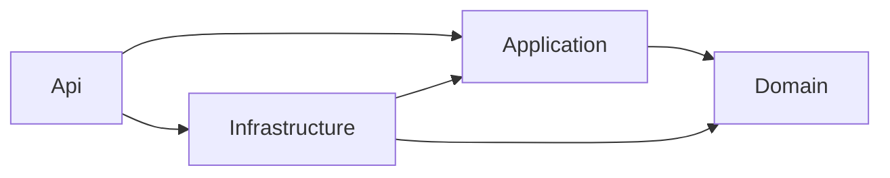

# Arquitectura y convenciones

HotelManagement utiliza .NET 10, ASP.NET Core, PostgreSQL y EF Core. Los casos
de uso siguen CQRS con MediatR 12.5.0; la interfaz Aurora es una web estática
servida por la API y utiliza autenticación JWT Bearer. Los tokens de acceso se
mantienen únicamente en memoria del cliente y expiran por defecto a los 15 minutos.

## Estructura

```text
HotelManagement/
├── src/
│   ├── HotelManagement.Api/
│   │   ├── Authorization/       Roles y políticas de acceso
│   │   ├── Configuration/       Registro de servicios HTTP y autenticación
│   │   ├── Controllers/         Endpoints que envían Commands y Queries
│   │   ├── ErrorHandling/       ProblemDetails y manejo central de errores
│   │   ├── Security/            Emisión de tokens JWT firmados
│   │   └── wwwroot/             Interfaz Aurora: HTML, CSS, JS e imágenes
│   ├── HotelManagement.Application/
│   │   ├── Configuration/       AddApplication y registro de MediatR
│   │   ├── Dtos/                Contratos agrupados por funcionalidad
│   │   ├── Exceptions/          Errores de aplicación
│   │   ├── Interfaces/          IUnitOfWork y Services/IAccessTokenIssuer
│   │   ├── Mappings/            Conversión entre entidades y DTOs
│   │   ├── Security/            Contrato del servicio de hashing
│   │   ├── Transactions/        Behavior transaccional y marcador de comandos
│   │   └── UseCases/            Commands, Queries y sus handlers
│   ├── HotelManagement.Domain/
│   │   ├── Entities/            Entidades sin dependencias de persistencia
│   │   ├── Repositories/        Contratos de acceso a datos por entidad
│   │   ├── Exceptions/          Conflictos y validaciones de negocio
│   │   └── Rules/               Políticas de reservas y estadías
│   └── HotelManagement.Infrastructure/
│       ├── Configuration/       AddInfrastructure y registro de dependencias
│       ├── Persistence/         HotelManagementDbContext y modelo de EF Core
│       ├── Repositories/        Implementaciones PostgreSQL
│       └── Security/            Hashing y aprovisionamiento demo
├── database/                    Esquema, seed e incrementos SQL versionados
├── tests/HotelManagement.Api.Tests/
├── scripts/                     Publicación y verificación de entrega local
├── .github/workflows/ci.yml      Compilación, PostgreSQL, pruebas y publicación
└── docs/                        Arquitectura, decisiones y evidencias
```

## Dependencias entre capas



Domain permanece independiente de las otras capas, EF Core y Npgsql.
Application referencia Domain; no referencia Infrastructure ni la API.
Infrastructure implementa los contratos de repositorio y seguridad.
La API compone los registros AddApplication, AddInfrastructure y sus servicios
HTTP. Las pruebas acceden a la aplicación mediante la API y sus dependencias.

Las políticas principales de reservas y estadías están en Domain.Rules. Los
handlers coordinan casos de uso; Infrastructure lee datos bajo bloqueo, invoca
esas políticas y persiste los resultados. Las restricciones SQL se conservan
como defensa de integridad y concurrencia. Otros módulos aún contienen reglas
en handlers y repositorios.

Application define IUnitOfWork y TransactionBehavior. Infrastructure implementa
ese puerto mediante EfUnitOfWork y un DbContext scoped compartido. Los comandos
de negocio marcados como ITransactionalRequest confirman todos sus cambios al
finalizar o los revierten ante error/cancelación. El caso compuesto huésped +
reserva demuestra la coordinación entre repositorios. Ver
[unidad de trabajo, reglas y guía de exposición](unidad-de-trabajo.md).

## Convenciones

- Usar `Application.Dtos.<Funcionalidad>` de manera uniforme, respetando el
  nombre `Dtos` de la carpeta. Las rutas HTTP y propiedades JSON se conservan.
- Commands en `UseCases/<Funcionalidad>/Commands` y Queries en `Queries`.
- Mantener los DTOs en Dtos y sus conversiones en Mappings. UseCases contiene
  Commands, Queries y handlers, sin clases auxiliares de mapeo.
- Las acciones de controllers envían solicitudes con ISender y propagan
  HttpContext.RequestAborted; el acceso a EF Core corresponde a Infrastructure.
- Los repositorios son específicos por entidad. Sus operaciones asíncronas
  reciben CancellationToken cuando corresponde.
- Las excepciones de dominio y aplicación se traducen centralmente a ProblemDetails.
- Los servicios se registran mediante las extensiones de cada capa. No crear
  archivos DependencyInjection duplicados de registros ya existentes.
- Los archivos de pruebas pertenecen al proyecto de tests, fuera de src.

## Persistencia y configuración

`Infrastructure/Persistence/HotelManagementDbContext.cs` representa el modelo EF.
El SQL de `database/` es la fuente de verdad, incluidas restricciones de exclusión
y triggers que no están representados por completo en el modelo generado.
Aplicar los incrementos en orden; actualmente 001–004. No se utilizan migraciones
EF paralelas al historial SQL. Ver [scaffolding](scaffolding.md).

La conexión se configura con `ConnectionStrings:DefaultConnection`, mediante
User Secrets en Development o variables de entorno. No se versionan conexiones
reales, contraseñas ni claves. La salud HTTP no comprueba PostgreSQL.
Las cuentas ficticias se aprovisionan explícitamente en Development; Production
requiere una base y cuentas existentes. Ver [entrega local](r06-entrega-local.md).
La clave JWT se configura fuera de Git con `Jwt:SigningKey` o `Jwt__SigningKey`.
La API valida firma, emisor, audiencia y expiración. Los permisos siguen basados
en roles. No se implementan refresh tokens ni revocación central en esta versión.
Ver [autenticación JWT](autenticacion-jwt.md).

## Aclaraciones para la revisión de arquitectura

### ¿Por qué existe tests? ¿Es vital para ejecutar el sistema?

No es un requisito de ejecución ni una capa de producción. Es un proyecto
separado que se agregó para repetir verificaciones de roles, validaciones,
concurrencia y transacciones con PostgreSQL real. Publicar la API no publica
el proyecto de pruebas. Se conserva porque permite comprobar que una
reorganización no altera las garantías existentes; Swagger cubre pruebas
manuales, pero no sustituye estas verificaciones automatizadas.

### ¿Dónde está Unit of Work y cómo usa genéricos?

El contrato está en `Application/Interfaces/IUnitOfWork.cs`. Su método
`ExecuteAsync<T>` es genérico: conserva el tipo de resultado del caso de uso
sin convertirlo a object ni duplicar contratos para cada DTO. La implementación
EfUnitOfWork permanece en Infrastructure. TransactionBehavior pertenece a
Application/Transactions y utiliza ese puerto.

No se agregó un Repository genérico: los contratos específicos expresan
operaciones reales, como disponibilidad, check-in y pagos, que requieren
consultas y bloqueos diferentes. No hace falta reemplazarlos por un CRUD
genérico para demostrar una unidad de trabajo.

### ¿Por qué usamos excepciones como un cortafuegos?

Es una analogía de contención de fallos, no un firewall de red. Una excepción
interrumpe una operación que no puede continuar correctamente. La unidad de
trabajo revierte sus escrituras y el handler HTTP central entrega una respuesta
controlada. Las excepciones de validación, conflicto y recurso inexistente
se traducen a 400, 409 y 404; los errores inesperados devuelven un mensaje
genérico y un traceId sin exponer detalles del proveedor ni secretos.

El rollback lo realiza Unit of Work, no la excepción por sí sola. No se cambió
el código de las excepciones ni GlobalExceptionHandler para esta reorganización.

### ¿Qué es wwwroot dentro de la API?

Es la raíz pública de archivos estáticos de ASP.NET Core. Contiene la web
Aurora: HTML, CSS, JavaScript e imágenes. UseDefaultFiles y UseStaticFiles
permiten servirla junto con la API desde el mismo origen. No es la raíz del
dominio ni una carpeta de casos de uso. Nunca se deben guardar secretos allí.
Separar el frontend en otro proyecto es posible, pero no es un requisito de
arquitectura hexagonal ni de integración por HTTP.

### Controllers y autenticación

Los controllers delegan la validación y decisiones de negocio a los casos de
uso. LoginCommand comprueba credenciales, actividad y roles y solicita un token
mediante `Interfaces/Services/IAccessTokenIssuer`. JwtTokenIssuer es el adaptador
JWT de la API; Application no referencia ASP.NET ni el proveedor de firma.
AccessTokenDto está en Dtos/Auth.

La validez del identificador del usuario se comprueba centralmente al validar
el JWT. AuthenticatedPrincipalExtensions adapta claims validados a la identidad
de aplicación. AuthenticationHttpResponse traduce el resultado de login a HTTP
200 o 401 y aplica no-store; esa traducción de protocolo pertenece al adaptador
HTTP. Los controllers ya no contienen if/else, análisis numérico de claims,
decisiones de credenciales ni emisión de tokens.

### Interpretación de la imagen de referencia y carpeta Security

La imagen muestra responsabilidades y dirección de dependencias; no obliga
a agregar RabbitMQ, correo o consola ni prescribe un nombre para cada carpeta.
Los controllers son adaptadores de entrada y los repositorios EF son
adaptadores de salida; Domain y Application forman el núcleo.

La propuesta verbal de reemplazar Security por Services no especificaba qué
contratos, implementaciones y capas debían moverse. Se conservaron las carpetas
Security existentes según la instrucción de no ejecutar esa parte ambigua.
El nuevo puerto IAccessTokenIssuer sí se ubica explícitamente en
Interfaces/Services, separado de su implementación técnica.

Resultado de esta revisión: 99 pruebas .NET y 3 JavaScript aprobadas, sin fallos
ni omisiones, con las integraciones PostgreSQL ejecutadas.

## Verificación y CI

El workflow `ci.yml` se activa en pushes, pull requests y ejecución manual:

1. Instala el SDK .NET 10 y levanta PostgreSQL 18 en un servicio temporal.
2. Restaura dependencias y compila Release tratando advertencias como errores.
3. Ejecuta la suite con R02_POSTGRES_ADMIN y sin paralelismo entre colecciones.
4. Rechaza resultados vacíos u omitidos y publica la aplicación Release.
5. Conserva resultados TRX y la publicación como artefactos identificados por SHA.

La contraseña del contenedor de CI es ficticia y desechable, independiente de
la base local. Cada prueba de integración crea y elimina su propia base aleatoria.
El workflow solo tiene permiso de lectura sobre el repositorio y no despliega.
Su resultado remoto se consulta en Actions; preparar el archivo no acredita
una ejecución de GitHub.

Antes de la reorganización semántica se ejecutaron las 50 pruebas en Release
con PostgreSQL local autenticado: 50 aprobadas, 0 fallidas, 0 omitidas.
También se comprobó la publicación Release. Las pruebas de integridad conservan
la cadena administrativa externa para crear conexiones nuevas sin perder su
contraseña al abrir la conexión principal.

La reorganización de namespaces se aplica mediante las referencias resueltas por
Rider. La verificación de cambios funcionales y de CI se distingue de esa operación.

Referencias: [setup-dotnet](https://github.com/actions/setup-dotnet) y
[servicios PostgreSQL de GitHub Actions](https://docs.github.com/en/actions/tutorials/use-containerized-services/create-postgresql-service-containers).

## Cambios funcionales posteriores

Auditoría completa con actor real, pruebas adicionales de caja concurrente y
registro automático de incrementos SQL requieren cambios propios. La interfaz
Y06 y la aceptación Y08 mantienen su seguimiento con el equipo. Esta organización
no implica que esos pendientes estén implementados.
