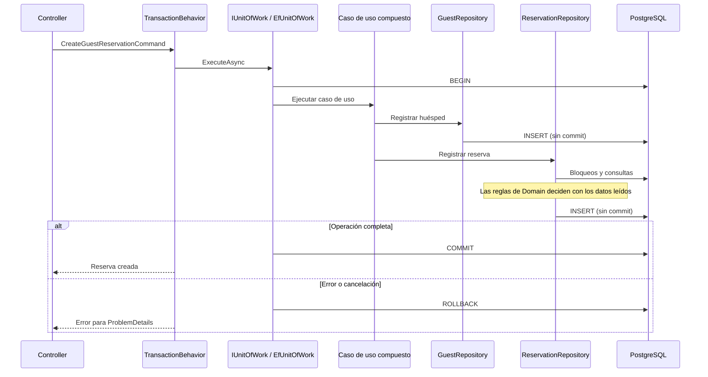

# Unit of Work y separación de reglas

## Qué problema resuelve

Registrar un huésped y luego una reserva con dos commits independientes puede
dejar un huésped creado aunque la reserva falle. La unidad de trabajo confirma
ambos cambios al terminar el caso de uso o revierte ambos si falla.

El ejemplo de producción es `POST /api/reservations/with-guest`, protegido por
la misma política Operations de las reservas: ADMIN o RECEPTION. Devuelve 201
con la reserva y su Location. Si falla la capacidad, las fechas o la
disponibilidad, el huésped nuevo tampoco queda registrado.
Los endpoints anteriores conservan sus contratos.

## Responsabilidades y puertos

| Componente | Responsabilidad |
| --- | --- |
| ReservationsController | Recibir HTTP y delegar en MediatR; no controla EF ni transacciones |
| CreateGuestReservationCommandHandler | Coordinar el registro del huésped y la reserva reutilizando sus comandos |
| ITransactionalRequest | Marcar explícitamente los comandos de escritura |
| TransactionBehavior | Envolver el caso de uso en IUnitOfWork y devolver el resultado después del commit |
| Application.Transactions.IUnitOfWork | Puerto transaccional independiente de EF Core y PostgreSQL |
| Domain.Repositories | Puertos de persistencia específicos por entidad |
| Domain.Rules | Decidir reglas de fechas, capacidad, disponibilidad, check-in y saldo de salida |
| Infrastructure.Repositories | Consultar hechos, obtener bloqueos, persistir y traducir errores de restricciones SQL |
| EfUnitOfWork | Adaptador que confirma o revierte una transacción ReadCommitted |
| HotelManagementDbContext | Contexto scoped compartido por los repositorios y la unidad de trabajo |



## Guardar no equivale a confirmar

Los repositorios mantienen `SaveChangesAsync` para obtener identificadores
generados y traducir errores SQL cerca de la escritura. Dentro de la unidad de
trabajo eso envía cambios a la transacción abierta: **no los confirma**.
Solo EfUnitOfWork confirma la transacción exterior.

RepositoryTransaction permite que los repositorios con bloqueos participen
en esa transacción sin abrir otra ni confirmarla. Sus llamadas directas,
fuera de un caso de uso transaccional, conservan una transacción local por
compatibilidad. Una llamada directa aislada no garantiza atomicidad con otro
repositorio: la coordinación corresponde a IUnitOfWork.

Los comandos anidados utilizan la misma unidad de trabajo scoped. Si alguno
falla, la operación completa queda marcada para rollback, incluso si el
consumidor captura la excepción. Después del rollback se limpia el tracking;
los objetos devueltos antes del fallo no deben reutilizarse como datos guardados.
El rollback usa un token no cancelado para poder ejecutarse aunque se cancele
la solicitud. Un DbContext y su unidad de trabajo se usan secuencialmente,
sin operaciones paralelas dentro del mismo scope.

Los comandos de negocio de escritura implementan ITransactionalRequest.
Las queries y el login no abren esta transacción de negocio. El login conserva
su actualización individual de último acceso y la emisión JWT existente.

## Reglas y concurrencia

ReservationRules concentra período válido, capacidad, habitación operativa y
decisión de disponibilidad. StayRules concentra estados permitidos, estadía
duplicada/abierta, catálogo activo, capacidad actual, fecha local del hotel,
mantenimiento y saldo pendiente. BusinessValidationException y
BusinessConflictException pertenecen ahora a Domain. El adaptador HTTP las
traduce a 400 y 409 con ProblemDetails.

Los repositorios todavía coordinan las lecturas y escrituras de cada operación
de persistencia; invocan las políticas del dominio después de obtener los datos
y bloqueos necesarios. No se eliminaron FOR UPDATE, restricciones de exclusión,
triggers ni el orden de bloqueos existente. Las restricciones SQL constituyen
una defensa adicional contra operaciones concurrentes.
Esta separación no implica que se hayan migrado todas las reglas de todos los
módulos: esta entrega centra las políticas en reservas y estadías.

## Cómo demostrarlo con Swagger

1. Iniciar la API en Development y abrir `/swagger`.
2. Hacer login y pegar accessToken en Authorize.
3. Elegir una habitación operativa y fechas disponibles.
4. Ejecutar POST `/api/reservations/with-guest` con un huésped nuevo:

```json
{
  "guest": { "firstName": "Demo", "lastName": "Atomicidad" },
  "roomId": 1,
  "checkInDate": "2030-06-01",
  "checkOutDate": "2030-06-02",
  "adults": 1,
  "children": 0
}
```

El ID y las fechas son ilustrativos: deben corresponder a los datos de la demo.
Para demostrar rollback, usar otro huésped identificable y una reserva que
supere la capacidad de la habitación. Se recibe 400 y no aparece ese huésped
al consultar huéspedes. Para mostrar commit, usar capacidad y fechas válidas;
el huésped y la reserva aparecen juntos. La web actual sigue utilizando sus
formularios separados; el flujo compuesto se demuestra por API/Swagger.

## Verificación reproducible

Configurar R02_POSTGRES_ADMIN externamente con permisos para crear bases de
prueba; cada integración crea una base aleatoria y la elimina en finally.

```powershell
dotnet build HotelManagement.sln --configuration Release --warnaserror
dotnet test HotelManagement.sln --configuration Release --no-build -- xUnit.ParallelizeTestCollections=false
node --test tests/web/auth-jwt.test.mjs
```

UnitOfWorkTests comprueba commit entre dos repositorios, rollback después de
guardar el huésped, fallo después de ambas escrituras, invisibilidad antes del
commit desde otra conexión, rollback de efectos de triggers, cancelación,
error anidado capturado y reutilización del scope tras rollback. También
comprueba el endpoint HTTP, autorización por rol, 400 ProblemDetails y 201.
DomainRulesTests comprueba límites de capacidad, fechas, día local de Lima,
estados de check-in y tolerancia de un centavo al cerrar la estadía.
Las pruebas existentes conservan el ciclo hotelero y las carreras de reserva,
check-in y cancelación.

Resultado local del 26/11/2026: **95 pruebas .NET aprobadas, 0 fallidas y 0
omitidas**, con PostgreSQL real; **3 pruebas JavaScript aprobadas**.
Compilación Release con advertencias tratadas como errores: 0 advertencias y
0 errores. Estos resultados corresponden al código de Unit of Work, sus reglas
y el endpoint compuesto, consolidado en **69d0924**. La separación de reglas
se encuentra en **399ba86**.

## Respuestas para la exposición

**¿Por qué no basta con Repository?** Cada repositorio conoce su persistencia,
pero el caso de uso decide qué operaciones forman una sola unidad atómica.

**¿DbContext ya es Unit of Work?** EF Core proporciona tracking y SaveChanges.
Nuestro puerto permite que Application controle el límite de la transacción
sin depender de EF. Su implementación comparte un DbContext scoped.

**¿Dónde empieza y termina la transacción?** El behavior de MediatR la abre
antes del handler del comando y la confirma después de completarlo. Una
excepción o cancelación revierte todos los cambios de esa operación.

**¿Cómo evitan la doble reserva?** Mantienen los bloqueos y restricciones
PostgreSQL dentro de la misma transacción. Unit of Work aporta atomicidad;
las garantías de concurrencia dependen también de esos mecanismos.

**¿Qué hace el middleware de errores?** Recibe las excepciones que salen del
caso de uso tras el rollback y entrega ProblemDetails sin filtrar secretos.
Autenticación y autorización se ejecutan antes de entrar al controller.
